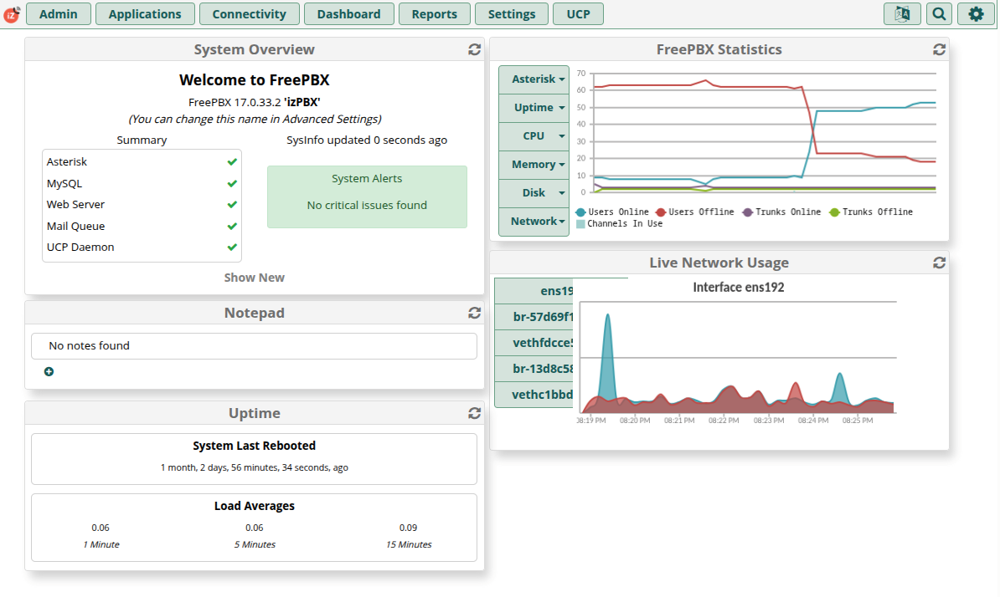
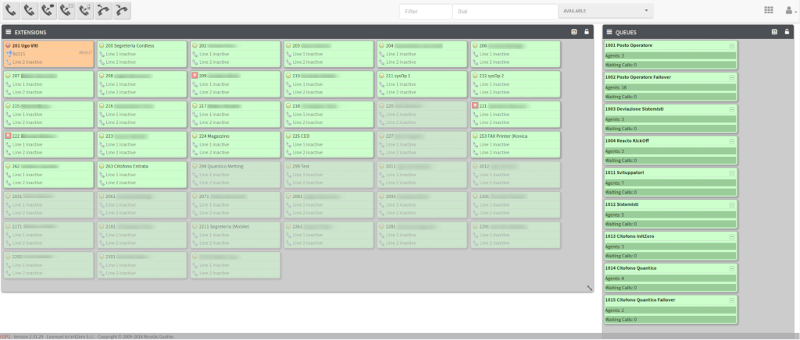
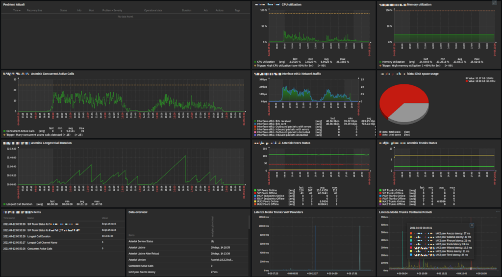
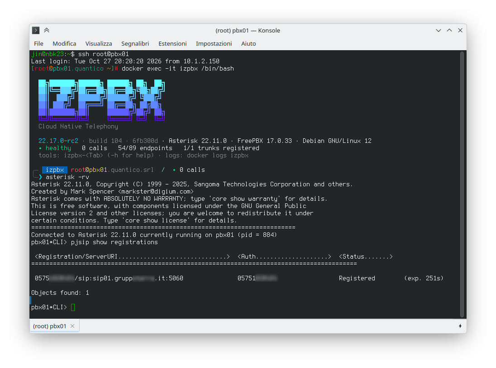

# Name
[](https://wearequantico.it) izPBX Cloud Native VoIP Telephony System

# Description
izPBX is a Turnkey Cloud Native VoIP Telephony System powered by Asterisk Engine and FreePBX Management GUI

# Supported tags

## Production Branch:
* `22.17`, `22.17.X`, `22.17.X-BUILD`, `22` (Asterisk 22 LTS + FreePBX 17, Debian 12, amd64 and arm64): the git branch `main`. To move from 20.16 to 22.17 see [Upgrade from 20.16 to 22.17](docs/upgrade-20.16-to-22.17.md)

## Previous Production Branch (security fixes only, until 2027-01-01):
* `20.16`, `20.16.X`, `20.16.X-BUILD`, `20`, `latest` (Asterisk 20 LTS + FreePBX 16): the git branch `release/20.16`. `latest` stays here for now, use an explicit tag

> **Still on izPBX 20.16?** Its deploy files, install and upgrade instructions are in the [`release/20.16`](https://github.com/ugoviti/izpbx/tree/release/20.16) branch: follow its README to update to the last 20.16 release (20.16.22) **before** migrating to 22.17 with [Upgrade from 20.16 to 22.17](docs/upgrade-20.16-to-22.17.md). Don't `git pull` the `main` branch in a 20.16 deploy directory: `main` holds 22.17 and no longer has `compose.yml` and `default.env` at its root.

## End of Life Branches (no more updates, don't use in production):
* `18.16`, `18.16.X`, `18.16.X-BUILD`,`18` (Asterisk 18 LTS + FreePBX 16)
* `18.15`, `18.15.X`, `18.15.X-BUILD` (Asterisk 18 LTS + FreePBX 15)
* `16.15`, `16.15.X`, `16.15.X-BUILD` (Asterisk 16 LTS + FreePBX 15)

## Development Branches:
* Asterisk 22 LTS + FreePBX 17: `dev-22.17`

## Version notes:
Tags format: **Z.Y.X-[BUILD]**

where:  
  * **Z** = Asterisk release (PBX engine)
  * **Y** = FreePBX release (PBX GUI)
  * **X** = izPBX release (this project)
  * **BUILD** = Build number

Look into project [Tags](https://hub.docker.com/r/izdock/izpbx-asterisk/tags) page to discover the latest versions

# Dockerfile
- https://github.com/ugoviti/izpbx/blob/main/izpbx-asterisk/Dockerfile

# Targets of this project
Cloud and On-Premise, Fast, Automatic and Repeatable deploy of VoIP PBX systems

# Features
- Fast initial bootstrap of a full-featured PBX system: a few minutes from zero to a running turnkey PBX (the healthcheck reports `healthy` when it is ready)
- Built-in PBX Engine based on Asterisk® 22 LTS (compiled from source, every download verified by sha256)
- Built-in WEB Management GUI based on FreePBX® 17 (default modules predownloaded in the image: the first install needs no module download)
- No vendor lock-in, you can migrate to and away from izPBX simply by importing/exporting FreePBX Backups
- Automatic migration of an izPBX 20.16 volume (FreePBX 16) to FreePBX 17, opt-in, verified and reversible (see [Upgrade from 20.16 to 22.17](docs/upgrade-20.16-to-22.17.md))
- Based on Debian 12 (bookworm) 64bit, amd64 and arm64 images (arm64: Raspberry Pi 4/5 with a 64-bit OS and ARM servers; no Digium `codec_opus`/`codec_silk`)
- Multi-Tenant PBX System Support (see [docs/multi-tenant.md](docs/multi-tenant.md))
- Automatic Remote XML PhoneBook support for compatible VoIP Phones
- Persistent storage mode for configuration and non-volatile data
- Fail2ban as security monitor to block SIP and HTTP brute force attacks
- FOP2 Operator Panel
- Integrated Asterisk Zabbix agent 2 for services health monitoring
- `izpbx-*` tools for the PBX (call stats, stuck calls, trunk rotation, BLF of trunk lines, LDAP address book, ...): see [izPBX tools](#izpbx-tools)
- `izsynth` utility - TTS/Text To Speech synthesizer, background music overlay assembler and audio file converter for PBX and Home Automation Systems
- `tcpdump` and `sngrep` utility to debug VoIP calls
- s6-overlay as services supervisor, with automatic restart of the failed services and a container `HEALTHCHECK`
- msmtp (default) or postfix MTA for sending mails (notifications, voicemails and FAXes)
- Integrated cron daemon for running scheduled tasks
- Integrated TFTP and DHCP server powered by DNSMasq for autoprovisioning VoIP Phones
- Integrated NTP Server
- Apache 2.4 and PHP 8.2 (mpm_event + php-fpm), ionCube loader for the commercial FreePBX modules
- Automatic Let's Encrypt HTTPS certificate management for exposed PBXs to Internet
- Custom commercial SSL Certificates support
- Logrotating of service logs
- All configurations made via single central `.env` file
- Many customizable variables to use (look inside [`default.env`](izpbx-asterisk/rootfs/usr/local/share/izpbx/deploy/default.env))
- Only two containers setup: (**Antipattern container design** but needed by the FreePBX ecosystem to work)
  - **izpbx** (izpbx-asterisk container: Asterisk Engine + FreePBX Frontend + other services)
  - **izpbx-db** (mariadb container: Database Backend)

# Screenshots
#### izPBX Dashboard (FreePBX):


#### izPBX Operator Panel (FOP2):


#### izPBX Monitoring Dashboard (Zabbix):


#### izPBX CLI (Asterisk):

  
# Deploy izPBX
Using **docker compose** is the suggested method:

- Install your preferred Linux OS into a VM or Baremetal Server

- Install Docker Runtime with `docker compose` plugin for your Operating System from https://www.docker.com/get-started
  - RHEL8 based distro Quick&Dirty commands (skip if you use other distribution):
```
sudo dnf config-manager --add-repo=https://download.docker.com/linux/centos/docker-ce.repo
sudo dnf install docker-ce docker-compose-plugin -y
sudo systemctl enable --now docker
```

- Create the deploy directory and write `compose.yml` and `.env` in it with `izpbx-deploy` (see [docs/izpbx-deploy.md](docs/izpbx-deploy.md)): image `22.17` is the last 22.17.x, `.env` gets its exact version and random database passwords:
```
mkdir -p /opt/izpbx && cd /opt/izpbx
docker run --rm --pull always -v "$PWD:/deploy" docker.io/izdock/izpbx-asterisk:22.17 izpbx-deploy init
```
  Without `izpbx-deploy`: download `compose.yml` and `default.env` (as `.env`) of the release, see [docs/izpbx-deploy.md](docs/izpbx-deploy.md#without-izpbx-deploy).

- Customize `.env` variables (see [Environment default variables](#environment-default-variables)):
  - `vim .env`

- Deploy and start izpbx using `docker compose` command:
  - `docker compose up -d`

- Wait for the first start to install FreePBX (a few minutes; `docker compose ps` shows `healthy` when it is done), then point your web browser to the IP address of your docker host and follow the initial setup guide

**Security:** by default the web interface (FreePBX, UCP and the `/pb` phonebook) accepts connections from any address (`HTTPD_ALLOW_FROM` not defined). If izPBX is reachable from the Internet, restrict `HTTPD_ALLOW_FROM` to trusted networks or put the web interface behind a VPN, and always use the latest izPBX release: it includes the latest PHP and Asterisk security fixes (ex. 20.16.22 fixes PHP CVE-2026-109618 and CVE-2026-109619).
Note that `MYSQL_PASSWORD` can't contain a single quote (`'`), two backslashes in a row or a final backslash (`\`): the FreePBX installer does not support them (izPBX refuses to start with such a password).

**Note:** by default, to correctly handle SIP NAT and SIP-RTP UDP traffic, the izpbx container will use the `network_mode: host`, so the izpbx container will be exposed directly to the outside network without using docker internal network range (**network_mode: host** will prevent multiple izpbx containers from running inside the same host).  
Modify compose.yml and comment `#network_mode: host` if you want to run multiple izpbx containers in the same host (not production tested. There will be problems with RTP traffic).
Another available option is to disable `network_mode: host` and use **macvlan** network mode used for running izPBX into multi-tenant mode.

## Customizing compose.yml

The versions of the images are in `.env`: `IZPBX_VERSION` (izPBX) and `MARIADB_VERSION` (MariaDB), always explicit versions, never `latest`. `compose.yml` reads them (`izpbx-asterisk:${IZPBX_VERSION}`, required: `izpbx-deploy` writes them), so a new release only changes `.env`.

If you need to customize the default `compose.yml`, don't edit it (`izpbx-deploy upgrade` replaces it with the one of the new version: local edits are merged, a conflict stops the upgrade), but create an **override** file:

- `compose.override.yml`

and specify the options you want to override, for example:

```
services:
  db:
    restart: always
  izpbx:
    restart: always
    hostname: pbx.example.com
```

and start the deploy with the same command `docker compose up -d`

## Alternative deploy method via 'docker run' command (not suggested)
If you want to test izPBX without using docker compose command, you can use the following docker commands:

1. Start MySQL:  
`docker run --rm -ti -v ./data/db:/var/lib/mysql -e MYSQL_ROOT_PASSWORD=CHANGEM3 -e MYSQL_PASSWORD=CHANGEM3 --name izpbx-db mariadb:10.11`

2. Start izPBX:  
`docker run --rm -ti --network=host --privileged --cap-add=NET_ADMIN -v ./data/izpbx:/data -e MYSQL_ROOT_PASSWORD=CHANGEM3 -e MYSQL_PASSWORD=CHANGEM3 -e MYSQL_SERVER=127.0.0.1 -e MYSQL_DATABASE=asterisk -e MYSQL_USER=asterisk -e APP_DATA=/data --name izpbx docker.io/izdock/izpbx-asterisk:22.17`

# Upgrade izPBX

> From izPBX 20.16.x (FreePBX 16) to 22.17.x (FreePBX 17) see [Upgrade from 20.16 to 22.17](docs/upgrade-20.16-to-22.17.md): it is not a plain image update.

1. In the deploy directory (eg. `/opt/izpbx`), see what the last 22.17.x (image `22.17`; an exact tag `22.17.N` picks another [release](https://github.com/ugoviti/izpbx/releases)) changes in `compose.yml` and `.env`; nothing is written:
```
docker run --rm --pull always -v "$PWD:/deploy" docker.io/izdock/izpbx-asterisk:22.17 izpbx-deploy upgrade
```
then write the changes: `IZPBX_VERSION` moves to the version of the image, the new variables are added, your values stay, the old files are kept as `.env.YYYYmmdd-HHMMSS.bak` and `compose.yml.YYYYmmdd-HHMMSS.bak` (see [docs/izpbx-deploy.md](docs/izpbx-deploy.md)):
```
docker run --rm --pull always -v "$PWD:/deploy" docker.io/izdock/izpbx-asterisk:22.17 izpbx-deploy upgrade --apply
```
Without `izpbx-deploy`: see [docs/izpbx-deploy.md](docs/izpbx-deploy.md#without-izpbx-deploy). In a deploy made with `git clone` of this repository don't `git pull` (git would delete `compose.yml`, no longer in the repository): use `izpbx-deploy`.

2. Upgrade the **izpbx** deploy with:
```
docker compose pull
docker compose up -d
```

3. If the mariadb database version was changed (`MARIADB_VERSION`), remember to update the tables schema with the command  
  `source .env ; docker exec -it izpbx-db mariadb-upgrade -u root -p$MYSQL_ROOT_PASSWORD`

4. Open FreePBX Web URL and verify if any module updates exist from FreePBX Menu: **Admin --> Modules Admin --> Check Online --> Upgrade all --> Process**

That's all

### Major FreePBX upgrades of older releases
FreePBX is installed into the persistent data dir on the first deploy only; later image updates of the same release update Asterisk and the image, not the FreePBX framework.

Up to izPBX 20.16 a major FreePBX upgrade (eg. FreePBX 15 to 16, from 18.15.x to 18.16.x) was done by the container with `FREEPBX_AUTOUPGRADE_CORE=true` or by hand with the FreePBX Upgrader module ([FreePBX 16 instructions](https://wiki.freepbx.org/display/FOP/Non+Distro+-+Upgrade+to+FreePBX+16)). From FreePBX 16 to 17 (izPBX 20.16 to 22.17) use the migration below: `FREEPBX_AUTOUPGRADE_CORE` does not do it.

# Upgrade from 20.16 to 22.17

izPBX 22.17 moves from FreePBX 16 / Asterisk 20 on Rocky Linux to **FreePBX 17 / Asterisk 22 on Debian 12** (PHP 8.2 with php-fpm, services supervised by s6-overlay, amd64 and arm64 images). A volume created by izPBX 20.16 is migrated by the container itself, but only when you ask for it: it is not a plain image update.

The short version:

1. update to izPBX **20.16.22** and upgrade all FreePBX modules;
2. switch the image to 22.17 and run the **checks** from the host, in the directory of `compose.yml` (`docker compose run --rm --no-deps --entrypoint izpbx-preflight izpbx`): fix what they report. The container runs the same checks by itself at every start on a 20.16 volume; running them first lets you read the report while 20.16 is still up;
3. **back up** `data/` and the databases;
4. set `IZPBX_MIGRATE_FREEPBX=true` and start the container: it migrates, verifies the result and starts;
5. keep the **snapshot** in `data/izpbx/.izpbx-migration/` until you are sure: `izpbx-rollback` goes back to 20.16 from it.

Read the full guide before starting: **[docs/upgrade-20.16-to-22.17.md](docs/upgrade-20.16-to-22.17.md)** (checks, backup, migration, what changes after it, rollback to 20.16).

# Advanced Production Configuration Examples

Multi-tenant deploys (many izPBX on one docker host, with dedicated databases or a shared one, macvlan networks): **[docs/multi-tenant.md](docs/multi-tenant.md)**.

# Services Management

Restart the whole deploy, the izpbx or the database container, or a single service inside izpbx (`izpbx-service`), and read the logs: **[docs/operations.md](docs/operations.md)**.

# izPBX tools
Commands of the izPBX image, to run inside the container (`docker exec -it izpbx <command>`); every one prints its usage with `-h`.

| Command | What it does |
|---|---|
| `izpbx-preflight` | Read-only checks before a migration from izPBX 20.16 (see [Upgrade from 20.16 to 22.17](docs/upgrade-20.16-to-22.17.md)) |
| `izpbx-rollback` | Back to izPBX 20.16 from the migration snapshot |
| `izpbx-inventory` | Inventory of the PBX (extensions, trunks, routes, files, ...) as JSON, `--diff` of two inventories |
| `izpbx-dialplan-convert` | Converts a custom dialplan of FreePBX 16 for Asterisk 22 (`Macro`, `MacroExit`, `SIPAddHeader`, `MessageSend` to `sip:`); `--check` only lists the changes and what cannot be converted |
| `izpbx-service` | `start`/`stop`/`restart`/`status` of a service |
| `izpbx-healthcheck` | The container healthcheck: prints `healthy` or why not |
| `izpbx-callstats` | The calls in progress: caller, called number, state, duration (`-b` brief, `-d` debug) |
| `izpbx-hangup-stucked-calls` | Hangs up the calls older than N seconds (default 5400; `-n` only lists them), eg. from cron |
| `izpbx-check-iax2` | Reloads `chan_iax2` when too many IAX2 peers are unreachable |
| `izpbx-trunkrotate` | Rotates the trunks of an outbound route at every run (eg. the SIMs of a GSM gateway): `izpbx-trunkrotate ROUTE TRUNK TRUNK...` |
| `izpbx-blfmonitor` | BLF of the lines of a trunk on `Custom:linea1..N` device states: `izpbx-blfmonitor -t TRUNK -l LINES start` |
| `izpbx-freepbx2ldap` | Exports the extensions to an LDAP address book (settings in `/etc/izpbx/freepbx2ldap.conf`: `LDAP_URI`, `LDAP_BIND_DN`, `LDAP_PASSWORD_FILE`, `LDAP_BASE_DN`, `LDAP_OU`) |
| `izpbx-enumrewrite` | Adds an ENUM domain at the head of the FreePBX ENUM lookups: `izpbx-enumrewrite e164.example.net` |
| `izpbx-reboot-device` | Reboots VoIP gateways and DECT bases through their web interface: `IZPBX_DEVICE_PASSWORD=... izpbx-reboot-device {portech\|grandstream-gxw\|kirk} HOST...` |
| `izpbx-mtrstats` | `mtr` reports to a host in a loop, to a log file (packet loss and latency of a trunk) |
| `izsynth` | Text to speech, background music and audio conversion for prompts |

# Tested systems and host compatibility
Tested Docker Runtime:
  - docker-ce >= 20.0
  - docker-compose-plugin >= 2.0

Tested Host Operating Systems:
  - RHEL 6/7/8/9 based distro
  - Fedora Core >30
  - Debian 10
  - Ubuntu 20.04

# Environment default variables
Consult the [`default.env`](izpbx-asterisk/rootfs/usr/local/share/izpbx/deploy/default.env) file: `izpbx-deploy` writes it as `.env` of a new deploy, `izpbx-deploy upgrade` brings an existing `.env` to its new version (see [docs/izpbx-deploy.md](docs/izpbx-deploy.md)).

# Zabbix Agent Configuration
Consult official repository page for installation and configuration of Asterisk Zabbix Template in your Zabbix Server:
- https://github.com/ugoviti/zabbix-templates/tree/main/asterisk

# FreePBX Configuration Best Practices
* **Settings-->Advanced Settings**
  * CW Enabled by Default: **NO**
  * Country Indication Tones: **Italy**
  * Ringtime Default: **60 seconds**
  * Speaking Clock Time Format: **24H**
  * PHP Timezone: **Europe/Rome**
  
* **Settings-->Asterisk Logfile Settings**
  * Security Settings-->Allow Anonymous Inbound SIP Calls: **No**
  * Security Settings-->Allow SIP Guests: **No**

* **Settings-->Asterisk SIP Settings**
  * File Name: **security**
  * Security: **ON** (all others OFF)
  
* **Settings-->Filestore-->Local**
  * Path Name: **Local Storage**
  * Path: **__ASTSPOOLDIR__/backup**

* **Admin-->Backup & Restore**
  * Basic Information-->Backup Name: **Daily Backup**
  * Notifications-->Email Type: **Failure**
  * Storage-->Storage Location: **Local Storage**
  * Schedule and Maintenance-->Enabled: **Yes**
  * Schedule and Maintenance-->Scheduling: Every: **Day** Minute: **00** Hour: **00**
  * Maintenance-->Delete After Runs: **0**
  * Maintenance-->Delete After Days: **14**

* **Admin-->Contact Manager**
  * External
    * Add New Group
      * Name: **PhoneBook**
      * Type: **External**
  
* **Admin-->Caller ID Lookup Sources**
  * Source Description: **ContactManager**
  * Source type: **Contact Manager**
  * Cache Results: **No**
  * Contact Manager Group(s): **All selected**
  
* **Admin-->Sound Languages-->Settings**
  * Global Language: **Italian**

# Configuring VoIP XML PhoneBook Lookup

- Visit **http://IZPBX_ADDRESS/pb/** to learn about the supported Phones and XML Address Books.

- Configure **Contact Manager** as reported above (create a new contact manager group name like **PhoneBook**)

## Define every PhoneBook you want to use
- Open your VoIP Phone GUI (example for Yealink Phones):
  - **Directory-->Remote Phone Book**
    - Index 1 (URL for Extensions PhoneBook)
      - RemoteURL: **http://IZPBX_ADDRESS/pb/yealink/ext**
      - Display Name: **Extensions**
    - Index 2 (URL for Corporate PhoneBook)
      - RemoteURL: **http://IZPBX_ADDRESS/pb/yealink/PhoneBook**
      - Display Name: **Corporate**

For Yealink / Fanvil phones you can use a single Phonebook Menu: **http://IZPBX_ADDRESS/pb/yealink/menu**

# FAQ / Troubleshooting
- FOP2 version: FOP2 is installed from its Debian package at the first start (`FOP2_ENABLED=true`), the version of the image (`FOP2_VER` in `izpbx-asterisk/versions.env`). With `FOP2_AUTOUPGRADE=true` (it needs a valid FOP2 upgrade subscription) an older installed FOP2 is upgraded to that version at start. Restart it with `docker exec -it izpbx izpbx-service restart fop2`.

- FOP2 useful commands:
    NB. define interface name to associate the license, for example: `eth0`
    - enter into izpbx container: `docker exec -it izpbx bash`
    - register the license: `/usr/local/fop2/fop2_server --rp=http --register --iface eth0 --name "Company Name" --code "LICENSECODE"`
    - get license details: `/usr/local/fop2/fop2_server --rp=http --getinfo --iface eth0`
    - reactivate the license: `/usr/local/fop2/fop2_server --rp=http --reactivate --iface eth0`
    - revoke the license: `/usr/local/fop2/fop2_server --rp=http --revoke --iface eth0`

- FOP2 is running in Demo mode because the license is invalid
  - FOP2 suffers from a bug in the licensing model (already reported many times to the FOP2 support without an official solution)
    to work around that problem, normally it is required to **reactivate** the license, but sometimes it doesn't work, so the only solution is to contact the FOP2 support team

- FreePBX is slow to reload (https://issues.freepbx.org/browse/FREEPBX-20559)
  - As WORKAROUND disable the module signature check: `FREEPBX_SIGNATURECHECK=0` in `.env` (applied at every start), or once with `docker exec -it izpbx fwconsole setting SIGNATURECHECK 0`

- Factory Reset izPBX (WARNING! your persistent storage will be wiped!):
  - `docker compose down`
  - `rm -rf data`
  - `docker compose up -d`
    
# Maintainers

Building the image, component updates, tests and releases: **[docs/maintainers.md](docs/maintainers.md)** and **[docs/development.md](docs/development.md)**.

# TODO / Future Development
- Kubernetes deploy via Helm Chart (major problems for RTP UDP ports range... needs further investigation, no valid solutions right now)
- Hylafax+ Server + IAXModem (used for sending FAXes. Receiving FAXes via mail is already possible using FreePBX FAX Module)
- macOS host support? (edit `compose.yml` and comment localtime volume?)
- Windows host support (need to use docker volume instead local directory path?)

# BUGS and Limits of this project
- izPBX was developed with container antipattern design in mind.
  - FreePBX was not designed to run as containerized app, and its ecosystem requires numerous modules to work
  - FreePBX module updates are managed by FreePBX Admin Modules Pages itself not by izPBX container updates
- izPBX must be deployed by 1 instance for every VM or Baremetal host
  - No multi deploy works out of the box by default when using `network_mode: host`
  - Look **Advanced Production Configuration Examples** section for Multi-Tenant Solutions
- By default `network_mode: host` is used, so the PBX network is exposed directly in the host interface (no internal container network is used), so the default UDP RTP port range can be set from `10000` to `20000`.
  - If you plan to disable `network_mode: host`, tune the port range (forwarding 10000 ports with the docker stack causes high CPU usage and longer startup times), for example for 50 concurrent calls:  
`APP_PORT_RTP_START=10000`  
`APP_PORT_RTP_END=10200`  
for best security, fine-tune the ports range based on your needs by not using standard port ranges!  
- Unpredictable network interface order when running in Multi-Tenant mode. As workaround, network interfaces must be named in lexical order. refs:
  - https://gist.github.com/jfellus/cfee9efc1e8e1baf9d15314f16a46eca
  - https://github.com/moby/moby/issues/20179
- By default FreePBX uses Signature Checking for module packages, which can cause long delays when reloading FreePBX: it can be disabled with `FREEPBX_SIGNATURECHECK=0`. refs:
  - https://issues.freepbx.org/browse/FREEPBX-20559
- Commercial FreePBX modules run (ionCube loader included) with their license; the parts of `sysadmin` that manage the operating system of the FreePBX Distro (rpm, network, updates) have no effect in a container
- The FreePBX 17 system prompts are downloaded by FreePBX at the first install: a new installation without Internet access starts without them (a migration from 20.16 takes them from the snapshot)
- Missing good EndPoint Manager for automatic phone provisioning
  - Looking for a valid solution
  
# Quick reference
- **Developed and maintained by**:
  [Ugo Viti](mailto:u.viti@wearequantico.it) @ [Quantico S.r.l.](https://wearequantico.it)

- **Where to file issues**:
  [https://github.com/ugoviti/izpbx/issues](https://github.com/ugoviti/izpbx/issues)

- **Where to get commercial help**:
  email: [support+izpbx@wearequantico.it](mailto:support+izpbx@wearequantico.it) - web: [Quantico](https://wearequantico.it)
  
- **Supported architectures**:
  [`amd64`, `arm64`] (`arm64` from 22.17; 20.16 is `amd64` only)

- **Supported Docker versions**:
  [the latest release](https://github.com/docker/docker-ce/releases/latest) (down to 1.6 on a best-effort basis)

- **License**:
  [GPL v3](https://github.com/ugoviti/izpbx/blob/main/LICENSE)
